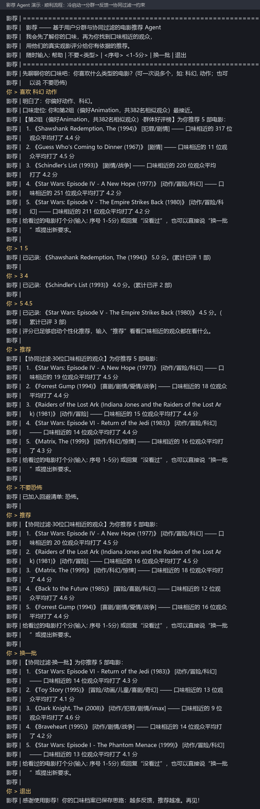

# 影荐 —— 基于用户分群与协同过滤的电影推荐 Agent

《机器学习》课程期末项目 · 0211232 班 · 王筠凯（学号 028123270）

## 1. 项目简介

**影荐** 是一个面向"不知道看什么电影"这一真实痛点的多轮交互式推荐 Agent。
它先通过冷启动问答了解用户的类型口味，用 **K-Means** 将用户定位到口味分群，
再结合 **基于用户的协同过滤（UserCF）**，用口味相近观众的真实评分给出**可解释**的推荐；
用户可以随时用自然语言提出约束（"不要恐怖"、"年代2000年后"），并通过打分反馈持续修正推荐。

```
冷启动问答 → 类型偏好画像 → K-Means 分群定位 → 分群好评榜（回退策略）
    ↓
用户打分反馈（≥3部） → 相似观众检索 → 协同过滤推荐 + 理由解释
    ↓
约束过滤（类型/年代/评分） → 换一批 / 继续反馈 → …
```

- **数据源**: [MovieLens ml-latest-small](https://grouplens.org/datasets/movielens/)（100,836 条评分 / 610 位用户 / 9,724 部电影，许可：仅供研究教学使用）
- **机器学习方法**: K-Means 聚类（用户分群）、基于用户的协同过滤（余弦相似度）、矩阵分解（TruncatedSVD 对照）、贝叶斯加权热门基线
- **Agent 组件**: 规则式意图解析（关键词匹配）、状态机多轮对话、约束过滤工具、置信度提示与失败回退（不依赖任何大模型 API，完全离线可复现）

## 2. 目录结构

```
├── README.md                        本文件
├── requirements.txt                 Python 依赖
├── data/ml-latest-small/            MovieLens 数据集（ratings/movies/tags/links）
├── src/                             源码
│   ├── data_loader.py               数据加载、偏好画像、训练/测试划分
│   ├── clustering.py                K-Means 分群（轮廓系数选 K、簇画像、新用户定位）
│   ├── recommender.py               6 种推荐算法 + 候选约束过滤工具
│   ├── evaluate.py                  评估协议（留一法排序指标、RMSE/MAE、冷启动、误差分析）
│   ├── agent.py                     影荐 Agent（多轮对话状态机）
│   └── run_interactive.py           交互模式入口
├── experiments/
│   ├── run_experiments.py           一键复现全部实验（E1-E6）
│   └── results/*.csv                实验结果表
├── demo/
│   ├── run_demo.py                  演示脚本（两个剧本会话）
│   ├── demo_session_A.txt/png       完整运行记录（顺利流程）
│   └── demo_session_B.txt           边界/失败处理记录
└── report/
    ├── 封面模板.doc                  课程提供的报告封面模板
    ├── figures/*.png                报告图表（由实验生成）
    └── 028123270_王筠凯_影荐Agent期末报告.docx / .pdf
```

## 3. 环境与安装

Python ≥ 3.10（开发环境为 Python 3.15 + scikit-learn 1.9 + pandas 3.1）

```bash
pip install -r requirements.txt
```

## 4. 复现步骤

```bash
# 1) 复现全部实验（约 3-5 分钟），生成 experiments/results/*.csv 与 report/figures/*.png
python experiments/run_experiments.py

# 2) 运行演示（生成 demo/demo_session_A/B.txt 与终端截图 PNG）
python demo/run_demo.py

# 3) 交互式体验 Agent（真实多轮对话）
python -m src.run_interactive
```

## 5. 使用示例（交互模式）

```
先聊聊你的口味吧：你喜欢什么类型的电影？
> 喜欢 科幻 动作
明白了：你偏好动作、科幻。
口味定位: 你和第2组（偏好Animation，共382名相似观众）最接近。
【第2组…·群体好评榜】为你推荐 5 部电影：
  1. 《Shawshank Redemption, The (1994)》 [犯罪/剧情] —— 317 位观众平均打了 4.4 分
> 1 5
已记录: 《Shawshank Redemption…》 5.0 分。(累计已评 1 部)
> 推荐
【协同过滤·30位口味相近的观众】为你推荐 5 部电影： …
> 不要恐怖
已加入回避清单: 恐怖。
```

支持的说法：`喜欢 X / 不要 X / 高分 / 年代2000后 / 序号+分数 / 没看过 序号 / 换一批 / 推荐 / 帮助 / 清除约束 / 退出`

## 6. 演示材料

完整运行记录见 [demo/demo_session_A.txt](demo/demo_session_A.txt)（顺利流程）与 [demo/demo_session_B.txt](demo/demo_session_B.txt)（边界与失败处理）；运行 `python demo/run_demo.py` 可重新生成。



## 7. 实验结论速览

| 方法 | HR@10 | 覆盖率@10 | 说明 |
|---|---|---|---|
| 随机 | 0.0000 | 0.4630 | 下界 |
| 全局热门 | 0.0181 | 0.0041 | 基线 |
| 分群热门（冷启动回退） | 0.0361 | 0.0073 | 聚类贡献 |
| UserCF 初版（归一化打分） | 0.0049 | 0.1142 | 误差分析发现设计缺陷 |
| **UserCF（加权和+支持度过滤）** | **0.0821** | 0.0347 | **最终方案，优于全部基线** |
| 分群协同过滤 | 0.0673 | 0.0333 | 消融：K=2 聚类约束略降性能 |
| 矩阵分解 SVD | 0.0673 | 0.0527 | 对照方法 |

评分预测 RMSE：SVD 0.997 < UserCF 1.022 < 全局均值 1.117。
冷启动实验表明已知评分 <20 条时分群热门更稳，≥20 条后协同过滤反超——这正是 Agent 分阶段策略的依据。
详细分析与失败案例见报告第 5-6 节。

## 8. 复用组件与许可

| 组件 | 版本 | 许可证 | 用途 |
|---|---|---|---|
| MovieLens ml-latest-small | 2018-09 发布版 | 仅供研究教育使用（GroupLens 使用条款） | 数据源 |
| scikit-learn | 1.9.1 | BSD-3-Clause | KMeans / TruncatedSVD / silhouette / StandardScaler |
| pandas | 3.1.1 | BSD-3-Clause | 数据处理 |
| numpy | 2.4.x | BSD-3-Clause | 数值计算 |
| matplotlib | 3.10.x | Matplotlib License | 实验图表 |
| Pillow | 11.x | MIT-CMU | 演示截图渲染 |
| python-docx | 1.1.2 | MIT | 报告生成 |

本项目的 Agent 框架、评估协议、UserCF 实现、实验脚本均为本人独立编写；
KMeans/TruncatedSVD 为 scikit-learn 库组件的直接复用（深入分析见报告第 4 节）。

## 9. 已知限制

- MovieLens 小数据集仅 610 位用户，UserCF 近邻稀疏，长尾电影（被看 <25 次）几乎无法召回（详见报告误差分析）；
- K-Means 最优 K=2（轮廓系数 0.087），说明口味空间连续性强，分群仅提供粗粒度定位；
- 意图解析为规则式关键词匹配，无法理解任意自然语言；未来可接入大模型做意图理解（复用课程中的文本表示方法）。
